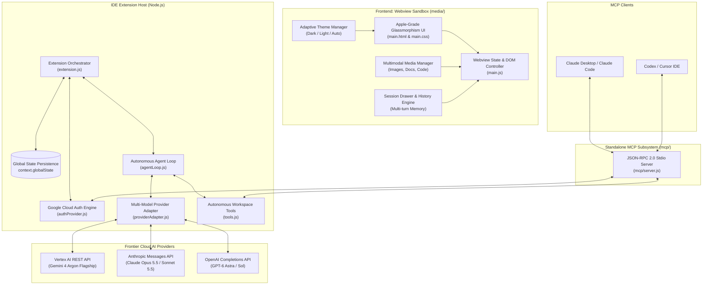

# 🏛️ Gemini 4 Argon Autonomous Agent - Architecture & System Design (v1.1.0)

**Author**: [Lucky Kuntal](https://github.com/ffzlucky7-coder)  
**Repository**: [https://github.com/ffzlucky7-coder/gemini-4-argon](https://github.com/ffzlucky7-coder/gemini-4-argon)  
**Target Environments**: Antigravity IDE, Visual Studio Code, Claude Desktop & Codex  
**AI Foundation**: Google Vertex AI (`gemini-4-argon`), Anthropic Claude 5.x, OpenAI GPT-6  

---

## 1. High-Level System Architecture

The **Gemini 4 Argon Autonomous Agent** is built on a decoupled, asynchronous, event-driven architecture designed to provide full autonomous coding capabilities natively within Antigravity IDE, VS Code, and MCP-compatible environments (Claude Desktop, Codex) while remaining completely self-contained (zero external npm dependencies, sub-50KB footprint).

---

## 2. Multi-Model Provider Architecture (`providerAdapter.js`)

The extension introduces a unified provider adapter that seamlessly routes user requests, attachments, and tool calls to the configured AI engine:

1. **Google Vertex AI (Default Engine)**:
   - Primary model: `gemini-4-argon`.
   - Hosted on Google Vertex AI `global` endpoint.
   - Deep reasoning budget with low/medium/high thinking levels.
   - Uses zero-dependency OAuth2 ADC or Service Account JWT token exchange.
2. **Anthropic Claude 5.x Tier**:
   - `claude-opus-5.5`: Flagship deep reasoning and complex multi-file engineering.
   - `claude-sonnet-5.5`: Fast, high-effort daily coding workhorse.
   - `claude-fable-5.1`: Mythos class frontier reasoning.
   - `claude-haiku-5.5`: Fastest and most cost-effective tier.
3. **OpenAI GPT-6 Tier**:
   - `gpt-6-astra`: Flagship software engineering model.
   - `gpt-6.1-sol`: Near-Astra heavy code generation.
   - `gpt-6-luna`: Rapid everyday iteration.

---

## 3. Model Context Protocol (MCP) Server (`mcp/server.js`)

Gemini 4 Argon includes an enterprise-grade standalone MCP server running over standard input/output (`stdio`) following the **JSON-RPC 2.0** protocol:
- Allows external clients like **Claude Desktop**, **Claude Code**, and **Codex** to leverage Gemini 4 Argon's tools directly.
- Exposes all 7 non-destructive workspace tools (`read_file`, `write_file`, `edit_file`, `list_dir`, `get_workspace_structure`, `search_code`, `run_command`).
- Exposes `gemini_4_argon_reason` enabling Claude or Codex to consult Gemini 4 Argon for second opinions, complex algorithmic validation, and root-cause debugging.

---

## 4. Multimodal Pipeline Architecture

The multimodal engine operates end-to-end without local disk temporary files:
1. **Client Capture**: Webview captures files via file input dialog or drag-and-drop into `#dragDropOverlay`.
2. **In-Memory Encoding**: `FileReader` reads files into base64 `data:` URIs and isolates MIME types.
3. **Optimized Payload Construction**:
   - For Vertex AI: Formatted into `{ inlineData: { mimeType, data } }`.
   - For Claude: Formatted into `{ type: 'image', source: { type: 'base64', media_type, data } }`.
   - For OpenAI: Formatted into `{ type: 'image_url', image_url: { url } }`.
4. **Visual Previews**: Frosted glass attachment chips in both composer and message history with file names, formatted sizes, and image thumbnails.

---

## 5. Autonomous Workspace Tools (`tools.js`)

- **`read_file`**: Reads UTF-8 contents with line-number precision and slice support.
- **`write_file`**: Writes files, auto-generating parent directories. Automatically creates `.argon_bak` backup before overwrite.
- **`edit_file`**: Surgical string search-and-replace refactoring.
- **`list_dir`**: Lists files and folders with sizes and subdirectories.
- **`get_workspace_structure`**: Recursive directory tree mapping ignoring `node_modules`, `.git`, `venv`, and `dist`.
- **`search_code`**: Multi-file regex and text search across the repository.
- **`run_command`**: Runs tests, linters, and build tools via `child_process.exec` with timeout, buffer management, and standard output/error capture.

---

## 6. Author Attribution

- **Creator & Architect**: [Lucky Kuntal](https://github.com/ffzlucky7-coder)
- **License**: MIT License (c) 2026 Lucky Kuntal
