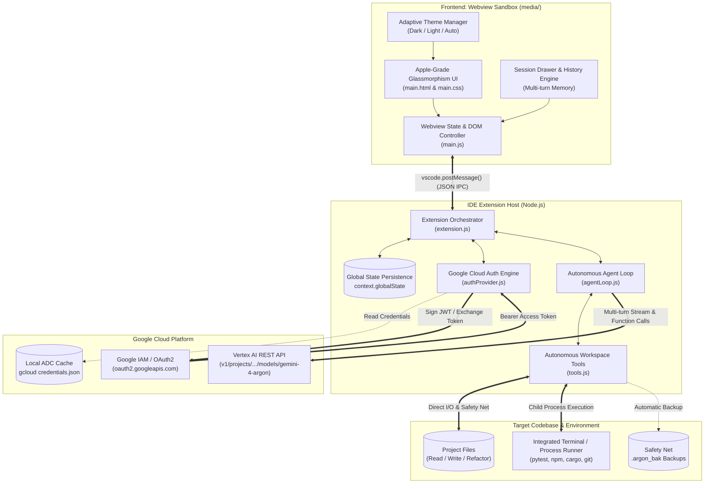
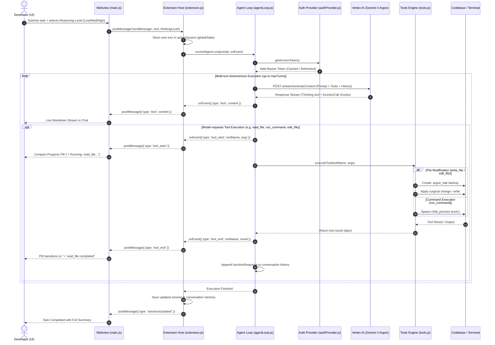

# 🏛️ Gemini 4 Argon Autonomous Agent - Architecture & System Design

**Author**: [Lucky Kuntal](https://github.com/ffzlucky7-coder)  
**Repository**: [https://github.com/ffzlucky7-coder/gemini-4-argon](https://github.com/ffzlucky7-coder/gemini-4-argon)  
**Target Environment**: Antigravity IDE & Visual Studio Code  
**AI Foundation**: Google Vertex AI Flagship — `gemini-4-argon`  

---

## 1. High-Level System Architecture

The **Gemini 4 Argon Autonomous Agent** is built on a decoupled, asynchronous, event-driven architecture designed to provide full autonomous coding capabilities natively within Antigravity IDE and VS Code while remaining completely self-contained (zero external npm dependencies, sub-40KB footprint).

---

## 2. Autonomous Execution Lifecycle (Sequence Diagram)

When a developer enters a task, the extension executes an autonomous multi-turn ReAct (Reason + Act) loop with dynamic parallel tool dispatching and safe fallback rollbacks.

---

## 3. Subsystem Breakdown

### 3.1. Webview Presentation Subsystem (`media/`)
- **`main.html`**: Semantic, accessible DOM structure utilizing custom frosted glass components, bottom-docked taskbars, SVG-only iconography, and zero remote asset dependencies.
- **`main.css`**: Apple-grade glassmorphism tokens, subpixel anti-aliasing (`-webkit-font-smoothing: antialiased`), dynamic Light/Dark mode themes (`[data-theme="dark"]` / `[data-theme="light"]`), fluid spring transitions (`cubic-bezier(0.34, 1.56, 0.64, 1)`), and zero horizontal scrollbar overflow rules (`word-break: break-all`).
- **`main.js`**: Pure vanilla JavaScript controller managing:
  - Markdown syntax rendering with custom syntax highlights and code copy buttons.
  - Multi-session drawer (load, switch, delete, new chat).
  - Subtle tool progress indicators (replaces raw JSON dumps).
  - Real-time reasoning mode selection.
  - Theme toggling with local storage memory.

### 3.2. Extension Host Orchestrator (`extension.js`)
- Registered as `WebviewViewProvider` under view container `gemini-4-argon.chatView`.
- Manages bidirectional JSON IPC with the webview.
- Implements `context.globalState` session persistence to retain conversation history across IDE restarts.
- Integrates external link delegation (`vscode.env.openExternal`) and file picker dialogs (`vscode.window.showOpenDialog`).

### 3.3. Autonomous Agent Loop (`agentLoop.js`)
- Handles the full recursive ReAct cycle with Gemini 4 Argon.
- Sends native function declarations for all 7 workspace tools.
- Supports **Thinking Level Configuration**: sets `thinkingLevel: 'low' | 'medium' | 'high'` directly in `thinkingConfig`.
- Parallel tool invocation handling: accurately matches and batches all `functionCall` items into a single `functionResponse` turn required by Google Vertex AI.
- Abort controller integration: cancels long-running requests instantly when the developer clicks `Stop`.

### 3.4. Autonomous Workspace Tools (`tools.js`)
- **`read_file`**: Reads UTF-8 contents with line-number precision and slice support.
- **`write_file`**: Writes files, auto-generating parent directories. Automatically creates `.argon_bak` backup before overwrite.
- **`edit_file`**: Surgical string search-and-replace refactoring.
- **`list_dir`**: Lists files and folders with sizes and subdirectories.
- **`get_workspace_structure`**: Recursive directory tree mapping ignoring `node_modules`, `.git`, `venv`, and `dist`.
- **`search_code`**: Multi-file regex and text search across the repository.
- **`run_command`**: Runs tests, linters, and build tools via `child_process.exec` with timeout, buffer management, and standard output/error capture.

### 3.5. Google Cloud Auth Provider (`authProvider.js`)
Supports 3 enterprise-grade authentication pathways:
1. **Application Default Credentials (ADC)**: Automatically reads `~/.config/gcloud/application_default_credentials.json` or `%APPDATA%\gcloud\application_default_credentials.json`, refreshing OAuth2 tokens automatically.
2. **Google Service Account JSON**: Generates RSA-SHA256 signed JWT assertions and exchanges them for OAuth2 bearer tokens via `https://oauth2.googleapis.com/token` without external libraries.
3. **API Key Fallback**: Direct header key authentication for express setups.

---

## 4. Key Architectural Safeguards

| Threat / Problem | Architectural Safeguard |
|---|---|
| **Accidental Code Overwrite** | Automatic `.argon_bak` timestamped snapshot created before write/edit operations. |
| **Runaway Agent Loops** | Strict `maxTurns` limit (default 25 turns) and user-triggerable `AbortController`. |
| **Large File / Token Blowup** | Range-based file slicing in `read_file` and directory exclusions in `get_workspace_structure`. |
| **UI Freezing on Deep Tasks** | Asynchronous streaming architecture with decoupled progress pills. |
| **Credential Exposure** | Zero telemetry, zero external logging, and settings stored securely in IDE configuration / global state. |
