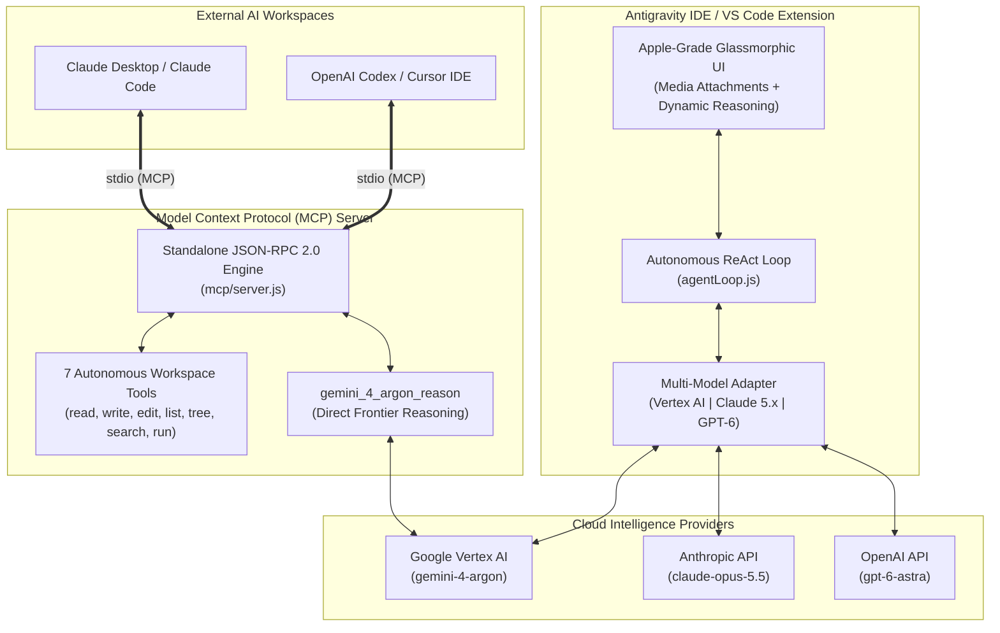

# 🚀 Gemini 4 Argon Autonomous Agent for Antigravity IDE, VS Code, Claude & Codex

### 👨‍💻 Created by [Lucky Kuntal](https://github.com/ffzlucky7-coder)

[](https://github.com/ffzlucky7-coder)
[](https://github.com/ffzlucky7-coder/gemini-4-argon)
[](https://modelcontextprotocol.io)
[](https://cloud.google.com/vertex-ai)
[](https://github.com/ffzlucky7-coder/gemini-4-argon)
[](#)
[](https://github.com/ffzlucky7-coder/gemini-4-argon)
[](#)
[](LICENSE)

> Developed by **Lucky Kuntal**, **Gemini 4 Argon** is a frontier autonomous software engineering agent that runs natively inside **Antigravity IDE**, **VS Code**, **Claude Desktop**, and **Codex / Cursor**. It features native multimodal attachments, deep reasoning budgets, autonomous workspace modification tools with automatic backups, and seamless multi-model support across **Gemini 4 Argon**, **Claude Opus 5.5**, and **GPT-6 Astra**.

---

## 🌟 What's New in v1.1.0

- 📎 **Multimodal File & Media Attachments**:
  - Drag-and-drop screenshots, architecture diagrams, UI mockups, or documents directly into the chat window.
  - Native paperclip button supporting images (`PNG`, `JPEG`, `WEBP`, `GIF`), documents (`PDF`, `TXT`, `CSV`, `JSON`), and source code files.
  - Real-time glass preview chips with file size badges and one-click removal.
- 🔌 **Claude Desktop & Codex Native MCP Server (`mcp/server.js`)**:
  - Full **Model Context Protocol (JSON-RPC 2.0)** server running over standard I/O (`stdio`).
  - Gives **Claude Desktop**, **Claude Code**, **Cursor**, and **Codex** full autonomous access to all 7 workspace tools plus `gemini_4_argon_reason`.
- 🧠 **Multi-Model Provider Adapter**:
  - **Google Vertex AI (Default)**: Flagship `gemini-4-argon` with free trial credits.
  - **Anthropic Claude 5.x Tier**: `claude-opus-5.5` (Deep Reasoning Flagship), `claude-sonnet-5.5` (Coding Workhorse), `claude-fable-5.1` (Mythos Class Frontier), and `claude-haiku-5.5` (Fast Everyday).
  - **OpenAI GPT-6 Tier**: `gpt-6-astra` (Flagship Software Engineering), `gpt-6.1-sol` (Heavy Coding), and `gpt-6-luna` (Fast Everyday).
- 💎 **Apple-Grade Glassmorphic UI**:
  - macOS Sonoma / visionOS inspired frosted glass surfaces and specular highlights.
  - High-contrast typography with instant Dark / Light mode switching.
  - Zero cheap emojis — 100% crisp vector SVG icons throughout the interface.

---

## 🏛️ System & MCP Architecture



---

## 🖥️ Complete Setup Guide: Claude Desktop

You can connect **Claude Desktop** directly to your local **Gemini 4 Argon MCP Server** so Claude gains full access to all 7 workspace tools and can consult Gemini 4 Argon for deep reasoning!

### Step 1: Locate your Claude Desktop Config File
- **Windows**: `%APPDATA%\Claude\claude_desktop_config.json`  
  *(Shortcut: Press `Win + R`, paste `%APPDATA%\Claude`, and press Enter)*
- **macOS**: `~/Library/Application Support/Claude/claude_desktop_config.json`
- **Linux**: `~/.config/Claude/claude_desktop_config.json`

### Step 2: Add the Gemini 4 Argon MCP Server
Open or create `claude_desktop_config.json` in any text editor, and add:

```json
{
  "mcpServers": {
    "gemini-4-argon": {
      "command": "node",
      "args": [
        "<ABSOLUTE_PATH_TO_GEMINI_4_ARGON>/mcp/server.js"
      ],
      "env": {
        "GEMINI_PROJECT_ID": "<YOUR_GOOGLE_CLOUD_PROJECT_ID>",
        "GEMINI_LOCATION": "global",
        "GEMINI_AUTH_METHOD": "adc"
      }
    }
  }
}
```

> **💡 Example Path**:
> - If you cloned this repository into `C:\projects\gemini-4-argon`, set `args` to:
>   `"args": ["C:/projects/gemini-4-argon/mcp/server.js"]` (use forward slashes `/`).
> - Replace `<YOUR_GOOGLE_CLOUD_PROJECT_ID>` with your own Google Cloud Project ID.

### Step 3: Restart Claude Desktop
Close Claude Desktop completely and reopen it. You will see a small **Hammer (`🛠️`) icon** at the bottom right indicating 8 tools are active:
- `gemini_4_argon_reason`
- `read_file`, `write_file`, `edit_file`
- `list_dir`, `get_workspace_structure`
- `search_code`, `run_command`

---

## 💻 Complete Setup Guide: OpenAI Codex / Cursor / Windsurf

You can use the exact same MCP Server in **Cursor**, **Windsurf**, or any **Codex MCP Client**:

### In Cursor / Windsurf IDE:
1. Open **Cursor Settings** (`Ctrl + ,` or `Cmd + ,`).
2. Navigate to **Features** -> **MCP**.
3. Click **+ Add New MCP Server**.
4. Enter:
   - **Name**: `gemini-4-argon`
   - **Type**: `command`
   - **Command**: `node <ABSOLUTE_PATH_TO_GEMINI_4_ARGON>/mcp/server.js`
5. Alternatively, create or edit `.cursor/mcp.json` in your project root:

```json
{
  "mcpServers": {
    "gemini-4-argon": {
      "command": "node",
      "args": [
        "<ABSOLUTE_PATH_TO_GEMINI_4_ARGON>/mcp/server.js"
      ],
      "env": {
        "GEMINI_PROJECT_ID": "<YOUR_GOOGLE_CLOUD_PROJECT_ID>",
        "GEMINI_LOCATION": "global",
        "GEMINI_AUTH_METHOD": "adc"
      }
    }
  }
}
```

Now Cursor's Agent or Codex can autonomously inspect, write, refactor, and test your codebase!

---

## 🤖 Full Autonomous Workspace Tools Reference

The agent has complete autonomous access to your project workspace through 7 non-destructive tools:

| Tool | Capabilities |
| :--- | :--- |
| `read_file` | Reads any file with line-number precision and range slicing. |
| `write_file` | Creates or updates files with automatic parent directory generation. |
| `edit_file` | Surgical search-and-replace refactoring. |
| `list_dir` | Explores directories and inspects folder structures. |
| `get_workspace_structure` | Maps recursive project architecture and file trees. |
| `search_code` | Ultra-fast regex and symbol searching across the entire repository. |
| `run_command` | Executes terminal commands: unit tests (`pytest`, `npm test`), linters, builds, and git operations. |

🛡️ **Zero-Loss Safety Net**: The extension automatically creates a `.argon_bak` backup before modifying or overwriting any existing file.

---

## 🎁 How to Claim $300 (₹26,000 INR) Free Credits on Google Cloud

Google Cloud offers **$300 USD (approx. ₹26,000 INR)** in 100% free credits for 90 days to any new Google Cloud account. Follow these steps to activate your free tier:

1. **Visit the Free Trial Page**:
   - Open [https://cloud.google.com/free](https://cloud.google.com/free) in your browser.
2. **Sign In**:
   - Click **"Get started for free"** and sign in with your Google account.
3. **Account & Verification**:
   - Select your Country.
   - Enter your name and address.
   - Add a credit/debit card for standard identity verification.
   - *Security Note:* Google only runs a temporary refundable verification check (₹2 in India / $1 USD) and immediately refunds it. **Google will NEVER automatically charge your card after the free trial ends** unless you explicitly choose to upgrade to a paid account.
4. **Welcome Credits Activated**:
   - Once verified, your account immediately receives **$300 USD credit (valid for 90 days)**!

---

## ⚡ Google Cloud Setup: What Every User Needs

To run Gemini 4 Argon with your own Google Cloud account, you only need **two things**:
1. Your own **Google Cloud Project ID**
2. **Vertex AI API Enabled** + **One Credentials Method** (ADC, Service Account JSON, or API Key)

### Step 1: Enable Vertex AI API
1. Open the [Google Cloud Console](https://console.cloud.google.com/).
2. In the top search bar, type `Vertex AI API`.
3. Select **Vertex AI API** from the results and click the blue **Enable** button.

### Step 2: Copy Your Project ID
1. In the Google Cloud Console top navigation bar, click on the project dropdown (next to "Google Cloud").
2. Copy your **Project ID** (e.g. `your-project-id-here`). Paste this into the extension settings.

---

## 🔑 Credentials Guide: 3 Easy Methods

You only need **ONE** of the following three authentication options:

```
┌────────────────────────────────────────────────────────────────────────┐
│                      Choose ANY 1 Auth Method:                         │
├──────────────────────────┬─────────────────────────┬───────────────────┤
│ Option A: ADC (Easiest)  │ Option B: Service Acct  │ Option C: API Key │
│ 1 terminal command       │ Best for sharing        │ Simple text key   │
└──────────────────────────┴─────────────────────────┴───────────────────┘
```

### Option A: Application Default Credentials (ADC) — *Recommended for Developers*
If you have the Google Cloud SDK (`gcloud`) installed:
1. Open your terminal (PowerShell, Command Prompt, or Terminal).
2. Run this single command:
   ```bash
   gcloud auth application-default login
   ```
3. A browser tab will open — select your Google account and click **Allow**.
4. **Done!** The extension automatically detects these credentials on your system. Zero file copying needed!

---

### Option B: Service Account JSON Key — *Recommended for Sharing with Friends*
If you want to use the extension without installing the `gcloud` CLI:
1. In Google Cloud Console, open the navigation menu (☰) and navigate to **IAM & Admin** -> **Service Accounts**.
2. Click **+ CREATE SERVICE ACCOUNT** at the top.
3. Enter a name (e.g., `gemini-argon-agent`) and click **Create and Continue**.
4. In the **Role** dropdown, select **Vertex AI** -> **Vertex AI User**. Click **Done**.
5. Click on the created service account from the list -> open the **Keys** tab.
6. Click **Add Key** -> **Create new key** -> select **JSON** -> click **Create**.
7. A `.json` key file will download to your computer.
8. In the extension:
   - Click the **⚙️ Settings** icon in the header.
   - Select Auth Method: **Service Account Key (JSON file)**.
   - Click **Browse...** and select your downloaded JSON key file.
   - Click **Save Settings**!

---

### Option C: Vertex AI API Key
1. In Google Cloud Console, navigate to **APIs & Services** -> **Credentials**.
2. Click **+ CREATE CREDENTIALS** -> **API key**.
3. Copy the generated key.
4. In the extension ⚙️ Settings, select Auth Method: **Vertex AI API Key**, paste your key, and click **Save Settings**.

---

## 🛡️ Budget Alert Guard (Ensure 100% Zero Out-of-Pocket Cost)

To ensure you never accidentally spend more than your free credits:
1. In Google Cloud Console, open the navigation menu (☰) and select **Billing**.
2. Click **Budgets & alerts** in the left sidebar.
3. Click **+ CREATE BUDGET**.
4. Set Target:
   - Scope: Select your Project.
   - Target amount: Set a small target like **$10 USD** (or **₹1,000 INR**).
   - Set threshold alerts at **50%**, **80%**, and **100%**.
   - Check the box: *"Email alerts to billing account administrators"*.
5. Click **Finish**. Google will email you well before you reach any billing threshold.

---

## 📦 Installation Guide

### Method 1: 1-Click Installer (Windows)
Double-click **`INSTALL.bat`** inside this repository folder! It automatically compiles and installs the extension directly into Antigravity IDE and VS Code.

### Method 2: Install via GUI (Antigravity IDE or VS Code)
1. Open Antigravity IDE or VS Code.
2. Press `Ctrl + Shift + P` (or `Cmd + Shift + P` on macOS).
3. Type and select: **`Extensions: Install from VSIX...`**.
4. Select `gemini-4-argon-1.1.0.vsix` from this folder.
5. Reload window (`Developer: Reload Window`).

### Method 3: Command Line Installation
Open your terminal in the directory where `gemini-4-argon-1.1.0.vsix` is located:

```bash
# For Antigravity IDE:
antigravity-ide --install-extension ./gemini-4-argon-1.1.0.vsix

# For standard VS Code:
code --install-extension ./gemini-4-argon-1.1.0.vsix
```

---

## 👤 Author & Creator

**Lucky Kuntal**
- **GitHub**: [@ffzlucky7-coder](https://github.com/ffzlucky7-coder)
- **Repository**: [https://github.com/ffzlucky7-coder/gemini-4-argon](https://github.com/ffzlucky7-coder/gemini-4-argon)
- **Created for**: Antigravity IDE, VS Code, Claude Desktop & Codex

---

## 📄 License

MIT License. Free to use, modify, and distribute.

Copyright (c) 2026 **Lucky Kuntal**.
