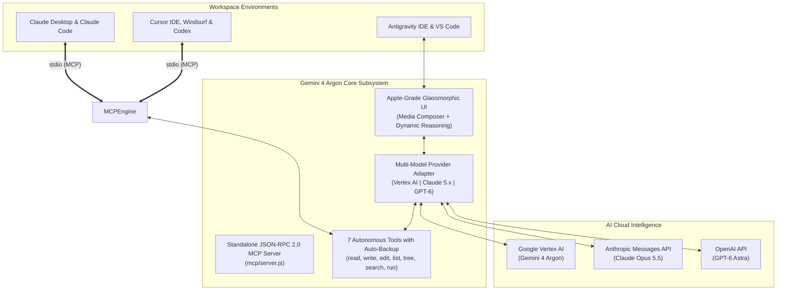

<div align="center">

# 🚀 Gemini 4 Argon
### Autonomous Coding Agent for Antigravity IDE, VS Code, Claude & Codex

**Created with ❤️ by [Lucky Kuntal](https://github.com/ffzlucky7-coder)**

[](https://github.com/ffzlucky7-coder)
[](https://github.com/ffzlucky7-coder/gemini-4-argon)
[](https://modelcontextprotocol.io)
[](CONTRIBUTING.md)
[](LICENSE)

<br/>

[](#-supported-ai-models-free-vs-frontier)
[](#-supported-ai-models-free-vs-frontier)
[](#-supported-ai-models-free-vs-frontier)

<br/>

[](https://cloud.google.com/vertex-ai)
[](#-multimodal-attachments-vision--files)
[](#-universal-compatibility--integrations)

<p align="center">
  <strong>Gemini 4 Argon</strong> is a frontier-grade, multi-platform autonomous software engineering agent.<br/>
  It executes real-world coding tasks with deep reasoning, autonomous workspace tools, automatic safety backups, and native vision — running with 100% zero crashes across Antigravity IDE, VS Code, Claude Desktop, and Cursor / Codex.
</p>

</div>

---

## 📑 Table of Contents

- [🧠 Supported AI Models (Free vs Frontier)](#-supported-ai-models-free-vs-frontier)
- [✨ Core Capabilities & Architecture](#-core-capabilities--architecture)
- [📎 Multimodal Attachments (Vision & Files)](#-multimodal-attachments-vision--files)
- [🔍 Pro Guide: How to Find Your Absolute Path](#-pro-guide-how-to-find-your-exact-absolute-path)
- [🖥️ Setup Guide: Claude Desktop](#️-setup-guide-claude-desktop)
- [💻 Setup Guide: Claude Code CLI](#-setup-guide-claude-code-cli)
- [⚡ Setup Guide: Cursor IDE, Windsurf & Codex](#-setup-guide-cursor-ide-windsurf--codex)
- [🎁 How to Claim $300 (₹26,000 INR) Google Cloud Free Trial](#-how-to-claim-300-26000-inr-free-credits-on-google-cloud)
  - [💳 Important: ₹1,000 Refundable Verification Deposit](#-important-note-on-the-1000-refundable-verification-deposit)
- [🔑 Google Cloud Setup & Auth Methods](#-google-cloud-setup--3-auth-methods)
- [🛡️ 100% Zero-Cost Budget Alert Guard](#️-budget-alert-guard-100-zero-cost-safeguard)
- [📦 Installation in Antigravity IDE & VS Code](#-installation-guide)
- [🤝 Contributing & Community Governance](#-contributing--community-governance)
- [👤 Author & License](#-author--creator)

---

## 🧠 Supported AI Models (Free vs Frontier)

<p align="center">
  <a href="https://svgl.app/directory/ai" target="_blank">
    
  </a>
  &nbsp;&nbsp;&nbsp;&nbsp;&nbsp;&nbsp;&nbsp;&nbsp;&nbsp;&nbsp;&nbsp;&nbsp;&nbsp;&nbsp;&nbsp;&nbsp;
  <a href="https://svgl.app/directory/ai" target="_blank">
    
  </a>
  &nbsp;&nbsp;&nbsp;&nbsp;&nbsp;&nbsp;&nbsp;&nbsp;&nbsp;&nbsp;&nbsp;&nbsp;&nbsp;&nbsp;&nbsp;&nbsp;
  <a href="https://svgl.app/directory/ai" target="_blank">
    
  </a>
</p>

Gemini 4 Argon is powered by a **Universal Multi-Model Adapter**. You can run the flagship **Google Gemini 4 Argon for 100% FREE** using trial credits, or plug in your own API key to tap into the latest frontier Claude and OpenAI models:

### 🌟 1. 100% Free Default Model (Out-of-the-Box)

<p align="left">
  
  <strong>&nbsp;Google Gemini 4 Argon (Vertex AI Global Endpoint)</strong>
</p>

| Model | Provider | Cost | Capabilities |
| :--- | :--- | :--- | :--- |
| **`gemini-4-argon`** | **Google Vertex AI** | **100% FREE** *(via ₹26,000 / $300 credit)* | Google's Flagship deep reasoning, native multimodal vision, autonomous tool calling, 25-turn self-healing loop. |

> **💡 Zero Subscription Needed:** Every new Google Cloud account gets **$300 (₹26,000 INR)** in credits, allowing you to use Gemini 4 Argon heavily for 90 days without paying a single rupee!

---

### 🚀 2. Frontier Multi-Model Engine (Bring Your Own Key)

Easily switch to these frontier models anytime from the extension **⚙️ Settings**:

####  Anthropic Claude 5.x Tier
| Model | Identifier | Purpose & Strength |
| :--- | :--- | :--- |
| **Claude Opus 5.5** | `claude-opus-5.5` | **Flagship Deep Reasoning**: Architectural system design, complex algorithmic logic, and repository-wide planning. |
| **Claude Sonnet 5.5** | `claude-sonnet-5.5` | **Coding Workhorse**: Rapid, high-effort everyday coding, multi-file refactoring, and bug fixes. |
| **Claude Fable 5.1** | `claude-fable-5.1` | **Mythos Class Frontier**: Advanced creative problem-solving and frontier exploration. |
| **Claude Haiku 5.5** | `claude-haiku-5.5` | **Fast & Lightweight**: Instant responses, quick documentation, and micro-edits. |

####  OpenAI GPT-6 Tier
| Model | Identifier | Purpose & Strength |
| :--- | :--- | :--- |
| **GPT-6 Astra** | `gpt-6-astra` | **Flagship Software Engineering**: Advanced code synthesis, logic proofing, and full-stack building. |
| **GPT-6.1 Sol** | `gpt-6.1-sol` | **Heavy Coding Tier**: High-volume refactoring, backend migrations, and code conversions. |
| **GPT-6 Luna** | `gpt-6-luna` | **Everyday Iteration**: Quick script generation, code explanations, and linting. |

---

## ✨ Core Capabilities & Architecture



### 🤖 The 7 Autonomous Workspace Tools

| Tool | Capabilities & Safeguards |
| :--- | :--- |
| `read_file` | Line-number window slicing (`startLine` to `endLine`). Reads files up to 100,000+ lines without token overflow. |
| `write_file` | Creates or overwrites files. Auto-generates missing folders and creates `.argon_bak` backup. |
| `edit_file` | Surgical search-and-replace refactoring with backup preservation. |
| `list_dir` | Explores directories and inspects folder sizes with recursive options. |
| `get_workspace_structure` | Maps recursive project trees while automatically ignoring `node_modules`, `.git`, `dist`, `__pycache__`. |
| `search_code` | Ultra-fast regex and symbol searching across the entire codebase. |
| `run_command` | Executes terminal commands (`pytest`, `npm test`, `cargo`, `git`) with a generous **5 MB output buffer**. |
| `gemini_4_argon_reason` | Direct deep reasoning consultation with Gemini 4 Argon inside Claude or Codex. |

---

## 📎 Multimodal Attachments (Vision & Files)

Gemini 4 Argon v1.1.0 features native multimodal capability:
1. **Paperclip Button (`📎`)**: Click the paperclip icon in the composer to select images, PDFs, or code files.
2. **Drag & Drop Overlay**: Simply drag any image, UI mockup, or document into the chat window — a frosted glass dropzone appears.
3. **Glass Preview Chips**: Attached files appear as compact pills with thumbnails, file size tags, and a 1-click remove button (`✕`).
4. **Zero-Disk In-Memory Encoding**: Files are securely encoded in Base64 in memory and sent directly via `inlineData` to Vertex AI / Claude / OpenAI.

---

## 🔍 Pro Guide: How to Find Your Exact Absolute Path

When setting up Claude Desktop or Codex, you need the absolute path to `mcp/server.js`. Here is the easiest way to find and copy it:

### 🪟 On Windows (Easiest Method):
1. Open File Explorer and navigate to the folder where you cloned or extracted `gemini-4-argon`.
2. Open the `mcp` folder.
3. Hold **`Shift`** on your keyboard, then **Right-Click** on `server.js`.
4. Click **"Copy as path"**.
5. When pasting into JSON, **replace backslashes `\` with forward slashes `/`**:
   - *Copied:* `"C:\projects\gemini-4-argon\mcp\server.js"`
   - *Converted for JSON:* `"C:/projects/gemini-4-argon/mcp/server.js"`

### 💻 Inside VS Code or Antigravity IDE:
1. In the left Explorer sidebar, expand the `mcp` folder.
2. Right-click on `server.js` and select **"Copy Path"**.
3. Paste it directly into your configuration.

### 🍎 On macOS or Linux (Terminal):
1. Open Terminal and `cd` into the repo's `mcp` directory.
2. Run:
   ```bash
   pwd
   ```
3. Append `/server.js` to the output (e.g., `/Users/username/gemini-4-argon/mcp/server.js`).

---

## 🖥️ Setup Guide: Claude Desktop

Connect **Claude Desktop** directly to Gemini 4 Argon so Claude can autonomously inspect, write, refactor, and test your projects!

### Step 1: Open Your Claude Desktop Config File
- **Windows**: Press `Win + R`, paste:
  ```
  %APPDATA%\Claude\claude_desktop_config.json
  ```
  and hit Enter (open with Notepad, VS Code, or any text editor).
- **macOS**: `~/Library/Application Support/Claude/claude_desktop_config.json`
- **Linux**: `~/.config/Claude/claude_desktop_config.json`

### Step 2: Add the Configuration
Add `gemini-4-argon` under `mcpServers`:

```json
{
  "mcpServers": {
    "gemini-4-argon": {
      "command": "node",
      "args": [
        "<ABSOLUTE_PATH_TO_GEMINI_4_ARGON>/mcp/server.js"
      ],
      "env": {
        "GEMINI_PROJECT_ID": "<YOUR_GOOGLE_CLOUD_PROJECT_ID>",
        "GEMINI_LOCATION": "global",
        "GEMINI_AUTH_METHOD": "adc",
        "GEMINI_WORKSPACE_ROOT": "<PATH_TO_YOUR_PROJECT>"
      }
    }
  }
}
```

> **💡 Real Example for Windows:**
> ```json
> {
>   "mcpServers": {
>     "gemini-4-argon": {
>       "command": "node",
>       "args": [
>         "C:/projects/gemini-4-argon/mcp/server.js"
>       ],
>       "env": {
>         "GEMINI_PROJECT_ID": "my-cool-project-12345",
>         "GEMINI_LOCATION": "global",
>         "GEMINI_AUTH_METHOD": "adc",
>         "GEMINI_WORKSPACE_ROOT": "D:/work/my-web-app"
>       }
>     }
>   }
> }
> ```

### Step 3: Restart Claude Desktop
Restart Claude Desktop. You will see a small **Hammer (`🛠️`)** icon in the bottom right with **8 active tools**:
`gemini_4_argon_reason`, `read_file`, `write_file`, `edit_file`, `list_dir`, `get_workspace_structure`, `search_code`, `run_command`.

---

## 💻 Setup Guide: Claude Code CLI

If you use Anthropic's **Claude Code** terminal tool:

```bash
claude mcp add gemini-4-argon node <ABSOLUTE_PATH_TO_GEMINI_4_ARGON>/mcp/server.js -e GEMINI_PROJECT_ID=<YOUR_PROJECT_ID>
```

---

## ⚡ Setup Guide: Cursor IDE, Windsurf & Codex

Use the exact same MCP Server inside **Cursor**, **Windsurf**, or **OpenAI Codex**:

### Method A: Via Cursor Settings UI
1. Open **Cursor Settings** (`Ctrl + ,` or `Cmd + ,`).
2. Navigate to **Features** -> **MCP**.
3. Click **+ Add New MCP Server**.
4. Set:
   - **Name**: `gemini-4-argon`
   - **Type**: `command`
   - **Command**: `node <ABSOLUTE_PATH_TO_GEMINI_4_ARGON>/mcp/server.js`

### Method B: Via `.cursor/mcp.json`
Create or edit `.cursor/mcp.json` in your project root:

```json
{
  "mcpServers": {
    "gemini-4-argon": {
      "command": "node",
      "args": [
        "<ABSOLUTE_PATH_TO_GEMINI_4_ARGON>/mcp/server.js"
      ],
      "env": {
        "GEMINI_PROJECT_ID": "<YOUR_GOOGLE_CLOUD_PROJECT_ID>",
        "GEMINI_LOCATION": "global",
        "GEMINI_AUTH_METHOD": "adc"
      }
    }
  }
}
```

Now Cursor's agent can autonomously use all 7 tools to inspect, write, refactor, and test your codebase!

---

## 🎁 How to Claim $300 (₹26,000 INR) Free Credits on Google Cloud

Google Cloud offers **$300 USD (approx. ₹26,000 INR)** in 100% free credits for 90 days to any new Google Cloud account. Follow these steps to activate your free tier:

1. **Visit the Free Trial Page**:
   - Open [https://cloud.google.com/free](https://cloud.google.com/free) in your browser.
2. **Sign In**:
   - Click **"Get started for free"** and sign in with your Google account.
3. **Account & Verification**:
   - Select your Country (e.g. India).
   - Enter your name and address.
   - Add a credit/debit card for standard identity verification.

---

### 💳 Important Note on the ₹1,000 Refundable Verification Deposit

> [!NOTE]
> **Why is there a ₹1,000 charge during signup?**
> - Under RBI (Reserve Bank of India) regulations and international payment security protocols, Google Cloud performs a **temporary pre-authorization charge of ₹1,000 INR** (or ₹2 depending on your card issuer) to confirm card authenticity.
> - **100% REFUNDABLE**: This is **NOT** a fee. The amount is **immediately refunded back to your bank account / card** within minutes or a few business days!
> - **No Automatic Billing**: Google Cloud explicitly guarantees that **your card will NEVER be charged automatically** when the free trial ends. To ever be charged, you would have to manually click an "Upgrade to Paid Account" button.
> - You get the full **₹26,000 ($300 USD)** in trial credits to run Gemini 4 Argon!

---

## 🔑 Google Cloud Setup & 3 Auth Methods

To connect Gemini 4 Argon with Google Cloud, you only need:
1. Your own **Google Cloud Project ID**
2. **Vertex AI API Enabled** + **Any ONE of the 3 Credentials Methods below**

### Step 1: Enable Vertex AI API
1. Open the [Google Cloud Console](https://console.cloud.google.com/).
2. In the top search bar, type `Vertex AI API` and click **Enable**.

### Step 2: Copy Your Project ID
1. In the top navbar, click on the project dropdown.
2. Copy your **Project ID** (e.g. `my-company-project-12345`).

### Step 3: Choose ANY 1 Auth Method:

```
┌────────────────────────────────────────────────────────────────────────┐
│                      Choose ANY 1 Auth Method:                         │
├──────────────────────────┬─────────────────────────┬───────────────────┤
│ Option A: ADC (Easiest)  │ Option B: Service Acct  │ Option C: API Key │
│ 1 terminal command       │ Best for sharing        │ Simple text key   │
└──────────────────────────┴─────────────────────────┴───────────────────┘
```

#### Option A: Application Default Credentials (ADC) — *Recommended for Developers*
Run this single command in your terminal:
```bash
gcloud auth application-default login
```
A browser tab will open — sign in and click **Allow**. The extension automatically detects this!

#### Option B: Service Account JSON Key — *Best for Sharing*
1. In Google Cloud Console, go to **IAM & Admin** -> **Service Accounts**.
2. Click **+ CREATE SERVICE ACCOUNT**, name it `gemini-argon`, grant role **Vertex AI User**.
3. Under the **Keys** tab, click **Add Key** -> **Create new key** -> **JSON**.
4. In the extension **⚙️ Settings**, select Auth Method: **Service Account Key (JSON file)** and browse to your file.

#### Option C: Vertex AI API Key
1. In Google Cloud Console, go to **APIs & Services** -> **Credentials**.
2. Click **+ CREATE CREDENTIALS** -> **API key**.
3. Paste it in the extension **⚙️ Settings** under **Vertex AI API Key**.

---

## 🛡️ Budget Alert Guard (100% Zero-Cost Safeguard)

To guarantee you never exceed your free credits:
1. In Google Cloud Console, open the navigation menu (☰) and select **Billing** -> **Budgets & alerts**.
2. Click **+ CREATE BUDGET**.
3. Set Target amount to a safe limit like **$10 USD** (or **₹1,000 INR**).
4. Check *"Email alerts to billing account administrators"*. Google will notify you long before reaching any threshold!

---

## 📦 Installation Guide

### Method 1: 1-Click Installer (Windows)
Double-click **`INSTALL.bat`** in this repository folder. It automatically registers the extension into Antigravity IDE and VS Code.

### Method 2: Install via GUI (Antigravity IDE or VS Code)
1. Open Antigravity IDE or VS Code.
2. Press `Ctrl + Shift + P` (or `Cmd + Shift + P` on macOS).
3. Type and select: **`Extensions: Install from VSIX...`**.
4. Select `gemini-4-argon-1.1.0.vsix` from this repository.
5. Reload window (`Developer: Reload Window`).

### Method 3: Command Line Installation
```bash
# For Antigravity IDE:
antigravity-ide --install-extension ./gemini-4-argon-1.1.0.vsix

# For standard VS Code:
code --install-extension ./gemini-4-argon-1.1.0.vsix
```

---

## 🤝 Contributing & Community Governance

We welcome contributions, bug reports, and pull requests!

To protect project stability, code security, and architectural integrity, all pull requests must be reviewed and approved by the maintainer: **[Lucky Kuntal](https://github.com/ffzlucky7-coder)**.

Please read our **[CONTRIBUTING.md](CONTRIBUTING.md)** and **[CODE_OF_CONDUCT.md](CODE_OF_CONDUCT.md)** before submitting code.

---

## 👤 Author & Creator

**Lucky Kuntal**
- **GitHub**: [@ffzlucky7-coder](https://github.com/ffzlucky7-coder)
- **Repository**: [https://github.com/ffzlucky7-coder/gemini-4-argon](https://github.com/ffzlucky7-coder/gemini-4-argon)
- **Designed for**: Antigravity IDE, VS Code, Claude Desktop, Claude Code & Codex

---

## 📄 License

MIT License. Free to use, modify, and distribute.

Copyright (c) 2026 **Lucky Kuntal**.
